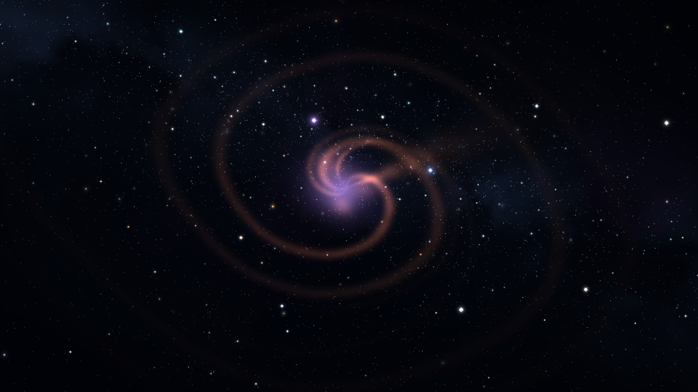
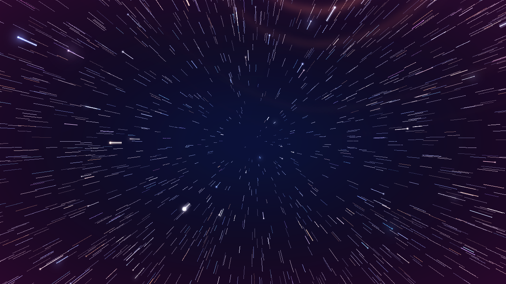
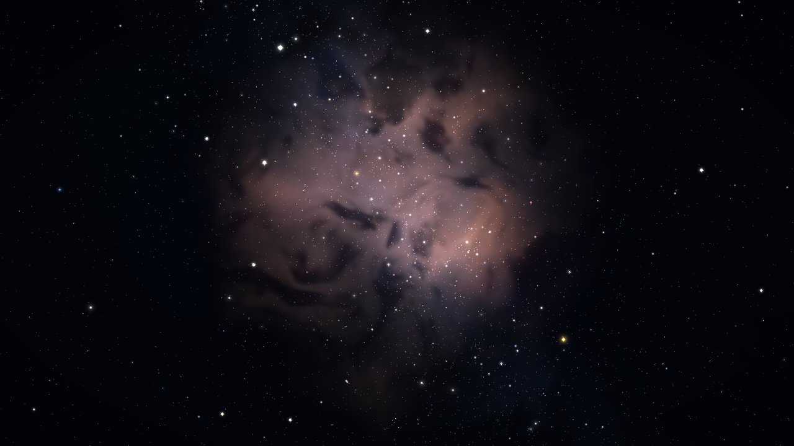
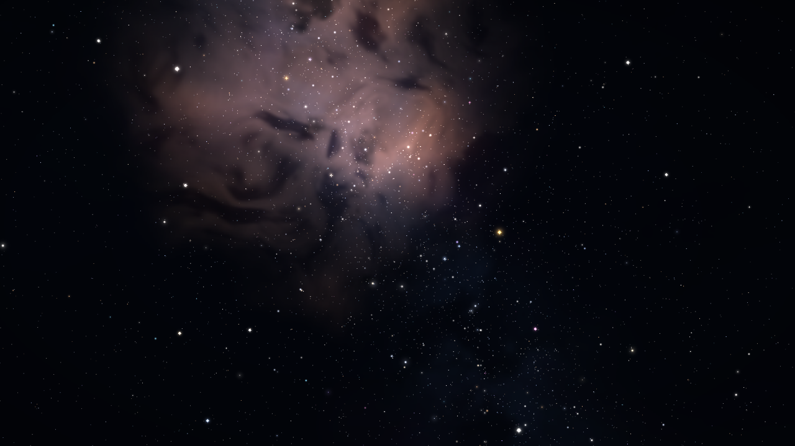

# Starfield Screensaver

Компактный Win32-скринсейвер: полёт через процедурные туманности и звёздные поля.
Чистый C++17 с программным рендерингом — без GPU, внешних библиотек и зависимостей
времени выполнения.

[](https://github.com/IljaGnezdilov/starfield-screensaver/actions/workflows/build.yml)
[](LICENSE)
[](https://github.com/IljaGnezdilov/starfield-screensaver/releases)

[English version](README.md)

| Спиральная туманность | Варп |
| --- | --- |
|  |  |

| Туманность «Розетка» | Эмиссионная туманность и галактическая полоса |
| --- | --- |
|  |  |

## Возможности

- Процедурные туманности трёх типов (эмиссия, оболочка, вспышка) с лопастями, дугами,
  джетами, пылевыми полосами и четырьмя палитрами.
- До 120 000 звёзд, разделённых на слабые, основные, яркие и избранные, с мерцанием,
  дифракционными лучами, боке, доплеровским оттенком и варп-штрихами.
- Детерминированный таймлайн: один seed задаёт расписание циклов, звёзды и небо.
  Кадры воспроизводимы для бенчмарков и дампов.
- Варп-переходы со смазанными штрихами, fade in/out и смягчённым фоном.
- Панорама на несколько мониторов: одно окно на дисплей и общий виртуальный bounding
  box, поэтому изображение стыкуется без швов.
- Программный фреймбуфер с аддитивным смешиванием, ограничение 16 Мп; фон рендерится
  в уменьшенном разрешении и растягивается с билинейной фильтрацией.
- Нативный диалог настроек Win32, хранение в реестре per-user, семантика
  сброс/отмена/OK, валидация и переопределения через командную строку.
- Режимы preview, оконный, бенчмарк и дамп кадров для разработки.

## Требования

- Windows 10 или 11 (сборка x64).
- Visual Studio 2022 с workload **Desktop development with C++** либо CMake 3.20+ с тем
  же тулчейном.
- Windows SDK.

## Сборка

```powershell
cmd /c build.bat
```

Скрипт находит MSVC через `vswhere`, компилирует ресурсы и линкует статически (`/MT`).
Результат — `build\Starfield.scr`. Используются `user32`, `gdi32`, `winmm`, `shell32`
и `advapi32`; `comctl32` не нужен.

Альтернатива через CMake:

```powershell
cmake -S . -B build-cmake
cmake --build build-cmake --config Release
```

При добавлении нового `.cpp` обновляй и `build.bat`, и `CMakeLists.txt`.

## Установка и запуск

1. Открой **Параметры → Персонализация → Экран блокировки → Заставка** и выбери
   `Starfield.scr`, либо нажми на `.scr` правой кнопкой и выбери **Установить** (файл
   копируется в системную папку, могут потребоваться права администратора).
2. Кнопка **Параметры** в диалоге заставки открывает настройки сцены.
3. Кнопка **Просмотр** показывает заставку в маленьком окне панели управления.

Windows запускает `.scr` через `ShellExecute` и может не передать аргументы командной
строки. Для тестов скопируй `build\Starfield.scr` в `build\Starfield.exe` и запускай
`.exe` из консоли.

### Командная строка

| Аргумент | Назначение |
| --- | --- |
| без аргументов или `/s` | Полноэкранный режим на всех мониторах |
| `/c` или `/c:12345` | Диалог настроек; число — необязательный owner HWND |
| `/p 12345` | Preview внутри родительского окна панели управления |
| `/w` | Оконный тестовый режим 1280×800, выход по Esc |
| `/bench:1920x1080 5` | Бенчмарк 5 секунд; размер опционален |
| `/dump:dump 1280x720` | Сохранить ключевые кадры в BMP |
| `/seed:12345` | Переопределить seed |
| `/round:5`, `/warp:1` и т.п. | Переопределить отдельные настройки |

В полноэкранном режиме выход: клик, клавиша, заметное движение мыши, потеря фокуса
дольше ~1.2 с или смена конфигурации дисплея. Первые ~0.7 с ввода игнорируются как
ложные срабатывания.

`/dump` делает 4 цикла и сохраняет до 150 кадров; имена вида `frame_001234.bmp`
соответствуют миллисекундам таймлайна. Для dump и bench асинхронная генерация неба
отключена, чтобы кадры были детерминированными.

## Настройки

Настройки хранятся per-user в `HKCU\Software\StarfieldScreensaver`; права
администратора не нужны. Если значения нет, используется значение по умолчанию. Float
и seed хранятся как строки, целые — как `REG_DWORD`.

Диалог `/c` — одна форма с тремя группами. «Сброс всех настроек» меняет только поля
формы; в реестр ничего не пишется до OK. «Отмена» отбрасывает все изменения. OK
валидирует значения, пересчитывает производные тайминги и сохраняет.

### Таймлайн

| Параметр | Ключ реестра | По умолчанию | Диапазон |
| --- | --- | ---: | --- |
| Seed | `seed` | `-1` (случайный) | `-1..4294967295` |
| Длительность раунда, с | `round_seconds` | 5 | 1–60 |
| Угол за раунд, ° | `angle_min` / `angle_max` | 16 / 40 | 10–360 |
| Раундов до варпа | `rounds_min` / `rounds_max` | 1 / 5 | 1–100 |
| Варп, с | `warp_seconds` | 1 | 0.1–5 |

Производные значения не хранятся в реестре:

```text
segmentEaseSeconds = min(0.5, round_seconds * 0.25)
fadeInSeconds      = min(0.7, round_seconds * 0.5)
fadeOutSeconds     = min(0.4, warp_seconds * 0.5)
```

### Туманности

| Параметр | Ключ | По умолчанию | Диапазон |
| --- | --- | ---: | --- |
| Интенсивность | `nebula_intensity` | 1 | 0.1–3 |
| Размер | `nebula_size` | 1 | 0.25–3 |
| Пыль | `nebula_dust` | 1 | 0–2 |
| Искажение | `nebula_warp` | 1 | 0–2 |
| Рваность края | `nebula_edge` | 1 | 0–2 |
| Палитра | `nebula_palette` | `-1` (случайная) | `-1..3` |
| Типы | `nebula_types` | 7 | mask 1/2/4 |
| Лопасти | `nebula_lobes_min/max` | 2/4 | 1–4 |
| Дуги | `nebula_arcs_min/max` | 1/3 | 1–3 |
| Джеты | `nebula_jets_min/max` | 2/5 | 1–5 |

Типы: `1` — эмиссия, `2` — оболочка, `4` — вспышка. Хотя бы один тип обязателен.
Количества выбираются случайно из `min..max` на каждый цикл.

### Звёзды

| Параметр | Ключ | По умолчанию | Диапазон |
| --- | --- | ---: | --- |
| Слабые | `stars_faint` | 26000 | 0–60000 |
| Основные | `stars_main` | 4200 | 0–30000 |
| Яркие | `stars_bright` | 140 | 0–3000 |
| Избранные | `stars_featured` | 3 | 0–3 |
| Размер | `star_size` | 1 | 0.25–5 |
| Яркость | `star_brightness` | 1 | 0.1–5 |
| Полоса | `star_band` | 1 (100%) | 0–1 |
| Мерцание | `star_twinkle` | 0.06 (6%) | 0–0.5 |
| Лучи основных | `star_spike_main` | 0.10 (10%) | 0–1 |
| Боке основных | `star_bokeh_main` | 0.10 (10%) | 0–1 |
| Боке ярких | `star_bokeh_bright` | 0.22 (22%) | 0–1 |
| Доплер | `star_doppler` | 1 (100%) | 0–3 |
| Варп | `star_warp` | 1 (100%) | 0.25–3 |
| Масштаб, px | `star_scale_min/max` | 0.6/2.5 | 0.1–8 |

Суммарное число звёзд ограничено 120 000. «Избранные» — три фиксированные яркие
звезды; хранится только количество от 0 до 3.

CLI-ключи совпадают с ключами реестра; дополнительно поддерживаются короткие алиасы
`/round`, `/warp`, `/seed`. После загрузки реестра и применения CLI все значения
проходят `clampSettings`, поэтому ручной запуск не может вывести параметры за
допустимые пределы.

## Как это устроено

```text
main.cpp       режимы, окна, per-monitor views, цикл кадра, bench/dump
settings.*     реестр, дефолты, clamp, строгая валидация, диалог Win32
starfield.*    таймлайн, расписание циклов, async sky, звёзды, warp/fade
sky.*          equirectangular текстура неба, туманности, палитры, blur
renderer.*     программный фреймбуфер и аддитивные примитивы
math.h         Vec3, Quat, детерминированный RNG
```

Поток кадра:

1. `Scene::prepare(t)` выбирает цикл, при необходимости подменяет готовое небо и
   запускает генерацию следующего.
2. `Scene::render()` считает параметры цикла, рисует фон и звёзды.
3. Каждый `Surface` имеет свой renderer и `View`; общий таймлайн один на приложение.
4. `Renderer::present()` отдаёт 32-битный DIB через `SetDIBitsToDevice` или
   `StretchDIBits`.

Ключевые решения:

- Один seed задаёт всё: расписание циклов, звёзды и небо. Seed каждого следующего
  цикла детерминированно смешивается из базового.
- Небо каждого цикла строится в фоновом потоке. На границе цикла поток
  присоединяется, готовая текстура подменяется; если не успела — генерируется
  синхронно.
- Полноэкранные окна создаются по одному на монитор. `View` использует общий bounding
  box всех мониторов, поэтому панорама стыкуется без швов и повторов.
- Фон рендерится в уменьшенном буфере (не более 1.2 Мп, примерно четверть кадра) и
  растягивается с билинейной интерполяцией. Звёзды рисуются в полном разрешении.
- Рендер аддитивный, каналы насыщаются на 255. Сортировка звёзд по яркости даёт
  стабильное наложение ярких поверх слабых.
- Полный кадр ограничен 16 Мп; если окно больше, renderer уменьшает внутренний буфер
  и растягивает его при выводе.

## Производительность

Ориентиры на машине разработчика: около 144–146 fps в 1080p и 42–45 fps в 4K.
Реальные цифры зависят от сцены, фона и нагрузки.

## Известные ограничения

- Диалог настроек — одна форма фиксированного размера (500×350 DLU). При очень
  высоком DPI он может выглядеть крупным; отдельного DPI-масштабирования нет.
- Максимум «избранных» звёзд жёстко равен 3.
- Сумма индивидуальных максимумов звёзд (93 003) меньше общего лимита 120 000; общий
  лимит остаётся страховкой и при превышении пропорционально уменьшает группы.
- Нет установщика, подписи кода и автоматической регистрации в системе. SmartScreen
  может предупредить о неподписанном исполняемом файле.
- Аргументы `.scr` через оболочку Windows могут теряться.
- Только Windows 10/11.

## Заметки для разработки

- Комментарии в коде — на английском; интерфейс и русский README — на русском.
- Новые `.cpp` добавляй и в `build.bat`, и в `CMakeLists.txt`.
- `/dump` и `/bench` отключают асинхронную генерацию неба ради детерминированности.
- Формат реестра и поток seed/RNG стоит менять только осознанно.

## Лицензия

MIT. См. [LICENSE](LICENSE).
